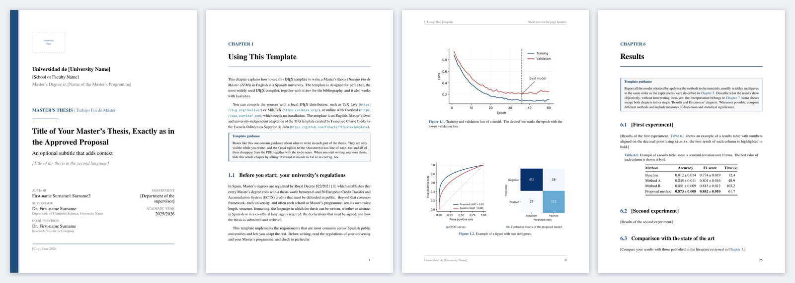

# Master's Thesis (TFM) LaTeX Template for Spanish Universities

[](https://github.com/thisisjosepablo/TFMLatexTemplate/actions/workflows/build.yml)
[](LICENSE)
[](https://www.overleaf.com/docs?snip_uri=https://github.com/thisisjosepablo/TFMLatexTemplate/releases/latest/download/TFMLatexTemplate.zip)

A complete, configurable LaTeX template to write a **Master's thesis
(*Trabajo Fin de Máster*, TFM) in English** at **any Spanish public university**.
Put your data in one file, pick a few options, and start writing.



📄 **[See the example PDF](main.pdf)**. It is also the user guide of the template.

---

## Features

- **University-independent.** University, school, degree, logos and corporate colour are just
  fields in `config.tex`. You can also use your university's **official PDF cover**.
- **The pages Spanish regulations usually ask for**, each one optional:
  - licence page (Creative Commons or all rights reserved);
  - supervisor's approval for the defence;
  - declaration of originality;
  - abstract and keywords in a **second language** (Spanish, Catalan, Valencian, Galician or
    Basque), with the matching hyphenation;
  - statement on the use of **generative AI**;
  - appendix on the **Sustainable Development Goals**.
- **Research-thesis structure** with a guidance box in every chapter: Introduction, Background,
  Objectives, Materials and Methods, Results, Discussion, Conclusions. Also included: guidance
  for professional or engineering projects.
- **Guidance boxes and to-do notes disappear** with a single option (`final`).
- **Review mode** with line numbers and a *DRAFT* watermark, so your supervisors can comment
  "page 12, line 34".
- **Digital or print layout.** In print mode chapters open on the right, the inner margin is
  wider and links are black.
- **Typography:**
  - three typefaces (Times-like, Arial-like, Latin Modern);
  - British or American English;
  - optional chapter titles in capitals.
- **Modern LaTeX stack:**
  - BibLaTeX + Biber, with any citation style (numeric, IEEE, APA, author–year…);
  - `cleveref` cross-references;
  - `siunitx` number alignment;
  - acronyms with an automatic list;
  - subfigures, TikZ, Gantt charts, algorithms and highlighted code.
- **Reproducible figures:** the scripts that generate the plots live in `figures/src/`.
- **pdfLaTeX and LuaLaTeX**, an optional **PDF/A-2b** output for institutional repositories,
  `latexmk` configuration and a `Makefile`.
- **Continuous integration.** Every change is compiled with many option combinations, and
  every release publishes the PDF and an Overleaf-ready ZIP.

## Quick start

### Overleaf (no installation)

1. Click **[Open in Overleaf](https://www.overleaf.com/docs?snip_uri=https://github.com/thisisjosepablo/TFMLatexTemplate/releases/latest/download/TFMLatexTemplate.zip)**.
   Or download `TFMLatexTemplate.zip` from the
   [latest release](https://github.com/thisisjosepablo/TFMLatexTemplate/releases/latest) and use
   *New Project → Upload Project* in Overleaf.
2. Keep the compiler set to **pdfLaTeX** (Menu → Compiler).
3. Edit `config.tex` and start writing.

### On your computer

You need a recent TeX distribution ([TeX Live](https://tug.org/texlive/) 2023 or newer, or
[MiKTeX](https://miktex.org/)). Both include `latexmk` and `biber`.

```bash
git clone https://github.com/thisisjosepablo/TFMLatexTemplate.git my-thesis
cd my-thesis
latexmk main.tex        # builds main.pdf
latexmk -pvc main.tex   # rebuilds automatically while you write
```

Better still, click **Use this template** at the top of this page to get your own repository with
the full history of your thesis under version control.

## Setting your data

Everything about you and your institution lives in **`config.tex`**:

```latex
\ThesisTitle{Title of Your Master's Thesis}
\ThesisTitleSecondLanguage{Título del trabajo en español}
\ThesisAuthor{First-name Surname1 Surname2}
\Supervisor{Dr. First-name Surname}{Department of ..., University of ...}
\Supervisor[Co-supervisor]{Dr. First-name Surname}{Company or institute}
\University{Universidad de ...}
\Faculty{School of ...}
\Degree{Master's Degree in ...}
\AcademicYear{2025/2026}
\UniversityLogo{figures/logos/university-logo.pdf}
\definecolor{tfmaccent}{HTML}{1F4E79}   % your university's colour
\ThesisLicence{by-nc-nd}                % or all-rights-reserved, by, by-sa...
\settoggle{tfmApprovalPage}{true}       % optional pages on/off
```

Leave any field empty and it disappears from the document. When you start writing your own
thesis, set `\settoggle{tfmTemplateGuide}{false}` to hide the user guide chapter. The remaining
chapters are renumbered automatically.

## Class options

Set them in the `\documentclass[...]{tfmthesis}` line of `main.tex`:

| Option | Values | Effect |
|---|---|---|
| `print` | – | Two-sided layout for a printed copy. Without it: digital (one-sided) layout. |
| `final` | – | Hides guidance boxes and to-do notes. |
| `review` | – | Line numbers and a *DRAFT* watermark. |
| `font` | **`serif`**, `sans`, `modern` | Times-like, Helvetica/Arial-like or Latin Modern. |
| `secondlanguage` | **`spanish`**, `catalan`, `valencian`, `galician`, `basque`, `none` | Language of the second abstract (*Resumen*, *Resum*, *Resumo*, *Laburpena*). |
| `bibstyle` | **`numeric-comp`**, `ieee`, `apa`, `authoryear`, … | Any BibLaTeX style. |
| `english` | **`british`**, `american` | Spelling and hyphenation. |
| `uppercase` | – | Chapter titles in capitals. |
| `11pt` | – | Smaller body text (default 12pt). |

Defaults are in bold. Example: `\documentclass[print, final, font=sans, secondlanguage=catalan, bibstyle=apa]{tfmthesis}`.

The layout defaults follow the most common Spanish regulations: A4, 2.5 cm margins, 1.5 line
spacing and 12 pt text. If yours differ, override them in `config.tex`, for example with
`\geometry{left=3cm}` or `\setstretch{1.25}`.

## Files

```text
├── main.tex                 # class options and order of the parts
├── config.tex               # ← your data
├── tfmthesis.cls            # the class (you do not need to edit it)
├── references.bib           # your references
├── frontmatter/             # dedication, acknowledgements, abstracts, AI statement, acronyms
├── chapters/                # 00-template-guide.tex … 07-conclusions.tex
├── appendices/              # SDG alignment, supplementary material
├── figures/                 # images (logos/ and the scripts in src/)
├── tables/                  # long tables in separate files
└── presets/                 # styles of specific universities
```

## University presets

A preset reproduces the specific rules of a university or school on top of the generic
template. Currently available:

- [`presets/uja-epsj.tex`](presets/uja-epsj.tex): Escuela Politécnica Superior de Jaén
  (Universidad de Jaén). It reproduces the style of the original template.

Would you like your university to be here? See [`presets/README.md`](presets/README.md) and
[CONTRIBUTING.md](CONTRIBUTING.md).

> **Always check the regulations of your university and Master's programme.** They decide the
> structure, length, language, declarations and submission process of your thesis. This template
> makes complying with them easy, but it cannot know them for you.

## Credits and licence

This template is an English, Master's-level and university-independent adaptation of the TFG
template by **Francisco Charte Ojeda** for the Escuela Politécnica Superior de Jaén:
[fcharte/TFGLatexTemplate](https://github.com/fcharte/TFGLatexTemplate).

Like the original, it is released under **[CC0 1.0 Universal](LICENSE)** (public domain). You
can use it for anything, without asking and without any condition, but also without any
warranty. Your thesis is yours: choose its own licence with `\ThesisLicence`.

---

## 🇪🇸 En español

Plantilla LaTeX para escribir el **Trabajo Fin de Máster en inglés** en cualquier universidad
pública española. Todos tus datos (universidad, centro, máster, tutores, logos y color
corporativo) se configuran en `config.tex`. Incluye las páginas que suelen exigir las
normativas españolas:

- portada (generada o la oficial de tu universidad en PDF);
- licencia;
- visto bueno de los tutores;
- declaración de originalidad;
- resumen y palabras clave en español o en una lengua cooficial;
- declaración de uso de IA generativa;
- anexo de ODS.

También ofrece:

- modo de revisión con números de línea;
- recuadros de ayuda que desaparecen en la versión final;
- versión digital o para imprimir.

Ábrela directamente en Overleaf con el botón de arriba y lee el capítulo *Using This Template*
del [PDF de ejemplo](main.pdf). Está basada en la plantilla de TFG de
[Francisco Charte Ojeda](https://github.com/fcharte/TFGLatexTemplate) para la EPSJ (Universidad
de Jaén). Revisa siempre la normativa de tu universidad y de tu máster.
